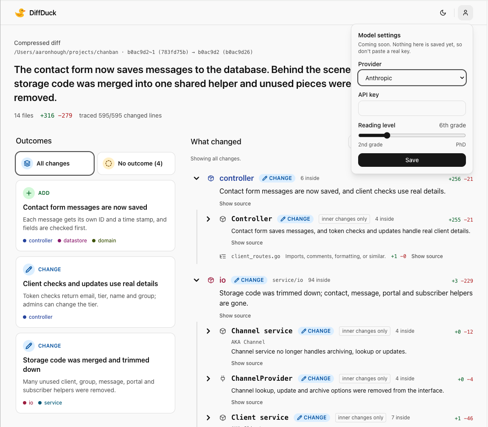

<p align="center">
  
</p>

<h1 align="center">DiffDuck</h1>

<p align="center"><strong>A compressed diff.</strong> Know what changed, and where, like a duck to water.</p>

<p align="center">
  
</p>

## About

A raw diff is a wall of red and green in file order. You have to read all of it to learn what it
does. DiffDuck compresses the same diff into something you can take in at a glance, without
hiding any of it.

It slices the change two ways:

- **By outcome: what changed.** A few plain-language results, like "Users can now log in with
  Okta". Pick one and the diff narrows to just the code behind it.
- **By structure: where it changed.** Package, then type, then function, each with a one-line
  description of its change. Start at the top and open only as deep as you need, down to the
  raw lines.

Every line is written for comprehension: short, direct, and easy to skim. Hard facts are kept
exact:

- **Nothing is dropped.** Every changed line traces to a node.
- **Nothing is invented.** Names, locations, and the shape of the tree come from the code, never
  from the model, and anything the model couldn't explain is marked as unexplained.

Also:

- **Local.** Runs on your machine, keeps your diffs in a private local database, and listens only
  on `127.0.0.1`.
- **Agent friendly.** One command builds a diff and prints its link, so your coding agent can
  "diffduck it" for you.

Go, Python, JavaScript/TypeScript, Rust, C#, and Java code gets the full structural tree. Other files appear as file-level changes.

## Install

```sh
go install github.com/arrno/diff-duck/cmd/diffduck@latest
```

Or from a clone: `make build`, which writes `bin/diffduck`.

## Use

From inside a Git repo:

```sh
diffduck diff
```

That diffs `HEAD~1..HEAD`, starts the app in the background if it isn't running, and opens the
result in your browser. **Your diffs live at http://127.0.0.1:7474/**, where you can also pick
commits by hand.

| Command | What it does |
| --- | --- |
| `diffduck diff [repo] [-f from] [-t to]` | Build a diff and open it. Defaults: `.`, `HEAD~1`, `HEAD`. Add `--wait` to wait for it to finish and print the overview, or `--no-open` to skip the browser. |
| `diffduck diff list [--json]` | List saved diffs and their IDs. |
| `diffduck diff show <id> [--json]` | Print one saved diff: its overview, outcomes, and changes. `--json` adds everything else, including the changed lines. |
| `diffduck diff open [id]` | Open the app, or one diff, in the browser. |
| `diffduck diff delete <id>...` | Delete saved diffs. |
| `diffduck settings [--json]` | Show the provider, reading level, each provider's availability, and which API keys are saved. Never prints a key. |
| `diffduck settings set [--provider id] [--reading-level id] [--api-key-stdin] [--json]` | Change the settings new diffs use. A flag left out keeps its saved value. |
| `diffduck settings clear-key <provider> [--json]` | Remove a saved API key. |
| `diffduck up` | Start the app in the background and print its address. Optional, since every `diff` command starts it. |
| `diffduck status` | Say whether the app is running, and where. |
| `diffduck down` | Stop the app. |
| `diffduck reset` | Delete every saved diff. Model settings are kept. Asks first, or pass `--yes`. |
| `diffduck serve` | Run the app in this terminal instead of the background. |

API keys are only read from a pipe, so they stay out of shell history and process listings:
`diffduck settings set --provider openai-api --api-key-stdin < key.txt`. `--api-key-stdin` needs
`--provider`, and the key is kept in the OS keychain.

Server options are flags on `up` (or `serve`) and apply until the next `down`. For example,
`diffduck up --port 8080`. Each new diff uses the provider and reading level saved in the app's
Model settings (default: Claude Code through the `claude` CLI, at a 6th-grade reading level).
`--adapter` (`claude-cli`, `codex-cli`, `anthropic-api`, or `openai-api`) pins every diff to that
adapter whatever provider is saved; when chosen this way, `anthropic-api` reads
`ANTHROPIC_API_KEY` and `openai-api` reads `OPENAI_API_KEY`, while providers chosen in the app use
keys saved in the OS keychain. `--model` sets the model only for the provider `--adapter` names
(`claude-cli` when not given). A `diff` that has to start the app uses the defaults.

Run `diffduck -h` for every flag, including a one-shot form that writes a standalone HTML file
without the app.

## From a coding agent

Add this to your `CLAUDE.md` or `AGENTS.md`:

```md
When I ask you to "diffduck" a change, commit it if it isn't committed, then run
`diffduck diff -f <base> -t <head> --wait` from the repo (defaults: HEAD~1 and HEAD) and give me
the URL it prints.
```

Agents can drive everything the app's form does. Use `diffduck settings --json` to see the current
provider and reading level, `diffduck settings set` to change them, `diffduck diff list --json` to
find diffs, and `diffduck diff show <id> --json` to read one. Errors go to stderr; the exit code is
`0` on success, `1` on failure, and `2` for a bad command line.

## Data

Saved diffs, the server record, and its log live in the DiffDuck home: `diff-duck` in your user
config directory, or `$DIFFDUCK_HOME`. The server listens only on `127.0.0.1`.
